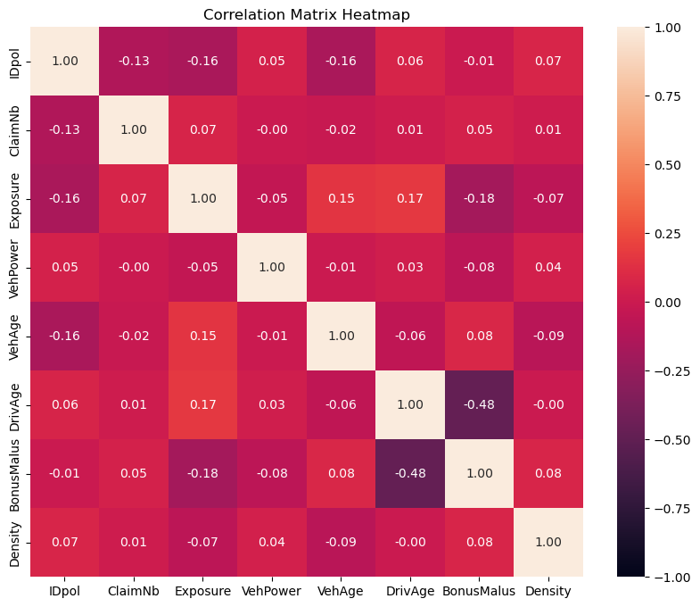

# Improving Motor Insurance Pricing Through Joint Modelling of Claim Frequency and Claim Severity

## Project overview

This project investigates whether machine-learning methods can improve motor third-party liability (MTPL) pure-premium predictions compared with traditional actuarial generalized linear models (GLMs). Pricing must be set before an insurer knows whether a policyholder will claim or the amount of any claim. Models that miss nonlinear effects and interactions can therefore lead to poor risk segmentation and adverse selection.

The study uses the freMTPL2 French motor insurance dataset to model claim frequency and severity, estimate expected claim cost per unit of exposure (pure premium), and examine model interpretability, calibration, and fairness.

## Research questions

1. Do gradient-boosting models (XGBoost or LightGBM) and neural networks improve on a Poisson GLM for claim frequency, as measured by Poisson deviance?
2. Does a Tweedie model or a separate frequency-and-severity approach produce better pure-premium estimates?
3. Which risk factors explain model predictions, and do model outcomes differ across age groups and regions?
4. How well calibrated are the models across risk deciles, as assessed with lift charts and the Gini index?

## Roadmap

### 1. Audit and prepare the data

- Inspect the frequency and severity files, schemas, record counts, missing values, ranges, and duplicate records.
- Document and resolve known inconsistencies between the two files; define and validate the policy-to-claim matching procedure.
- Preserve the distinction between policy-level frequency and claim-level severity.
- Account for differing policy exposure periods in frequency modeling and evaluation.
- Define a reproducible train/validation/test strategy and avoid leakage between related policy and claim records.
- Record all cleaning decisions and assumptions for the research methodology.

### 2. Explore the portfolio

- Summarize claim counts, zero-claim prevalence, exposure, and claim-cost distributions.
- Examine the distributions and relationships of driver, vehicle, geographic, and bonus-malus variables.
- Visualize potential nonlinearities and interactions, including driver age, vehicle power, and bonus-malus level.
- Build on the exploratory analysis already present in `Data_Analysis/generate_eda_report.py` and `Reports/EDA_Report.html`.

### 3. Establish actuarial baselines

- Fit a Poisson GLM for claim frequency with exposure handled appropriately.
- Fit a severity model on observed claims, selecting a suitable distribution and documenting the choice.
- Combine frequency and severity predictions to create a baseline pure-premium estimate.
- Fit a Tweedie model as an alternative pure-premium baseline.

### 4. Train machine-learning models

- Train and tune gradient-boosting models for frequency, severity, and/or pure premium, as supported by the data and evaluation design.
- Evaluate a neural-network approach if it is feasible within the project scope.
- Use consistent data splits and comparable feature preparation across candidate models.
- Keep hyperparameter selection separate from final test-set evaluation.

### 5. Compare predictive performance and calibration

- Compare frequency models using Poisson deviance.
- Evaluate severity and pure-premium predictions with metrics appropriate to their target distributions.
- Compare Tweedie and combined frequency-times-severity pure premiums.
- Assess calibration by risk decile and report lift charts and the Gini index.
- Present uncertainty and limitations alongside headline results.

### 6. Explain and assess model behavior

- Use SHAP analysis to identify influential predictors and investigate interactions.
- Compare explanations across the GLM and machine-learning models where practical.
- Assess calibration and prediction differences across age groups and regions.
- Discuss fairness findings in context, including the limits of the available data and chosen group metrics.

### 7. Document and reproduce the study

- Record dataset versions, preprocessing, feature definitions, model settings, and evaluation procedures.
- Cite the freMTPL2 data source from the CASdatasets R package (Dutang and Charpentier); verify the full bibliographic reference for the final paper.
- Summarize findings against each research question and clearly state limitations and future work.
- Ensure that the analysis can be rerun from the documented project files and dependencies.

## Data preparation: step-by-step

These are proposed preparation steps, not a completed pipeline. Keep the original CSV files unchanged and record the decisions made at each step.

1. **Load and understand the files.** Read `Data/freMTPL2freq.csv` as one row per policy and `Data/freMTPL2sev.csv` as one row per recorded claim amount. `IDpol` links the tables; it is unique in the policy table but can occur multiple times in the severity table.

2. **Audit each table.** Record row counts, column types, missing values, duplicate policy IDs, exact duplicate rows and value ranges. Check that `ClaimNb` is a nonnegative integer, `Exposure` is positive, and `ClaimAmount` is positive. Investigate unusual exposure periods and large claims rather than automatically deleting or capping them. Equal claim amounts are not necessarily duplicate claims.

3. **Reconcile the tables.** Count severity rows and sum `ClaimAmount` by `IDpol`; left-join these summaries to the policy table. Separately identify severity IDs without a policy, policies with claims but no severity records, and policies where `ClaimNb` differs from the number of severity records. Do not join the raw severity table to the frequency training table: multiple claims would duplicate the policy and its exposure.

   An earlier audit of the repository CSVs found 678,013 distinct policies and 26,639 severity records. Six severity IDs (195 records) did not match a policy; 9,117 policies had a claim-count/record-count mismatch. Recompute these figures if the files change and document the cause and treatment of each discrepancy.

4. **Define usable cohorts and handle missing outcomes.** Keep all valid policies for a frequency-only benchmark. For the initial pure-premium comparison, use a common cost-evaluable cohort of valid policies whose `ClaimNb` equals their matched severity-record count. Assign zero total cost to a zero-claim policy with no severity records; do **not** assign zero cost to a policy with claims but missing or mismatched amounts. Exclude unmatched severity records until they can be reliably linked to policy features. Report exclusions and compare their characteristics and exposure with those of the included policies: missing amounts may be systematic, so the cost-evaluable cohort may not represent the whole portfolio.

5. **Split by policy before fitting preprocessing.** Assign policy IDs to training, validation and test sets, for example 70% / 15% / 15%, using a recorded random seed. Stratify by whether a policy has a claim where practical. All claims for a policy must stay in the same split, and all models must use the same policy assignments. A random split measures performance on similar policies; it is not a substitute for testing on a later period.

6. **Prepare pricing features.** Use information available at pricing time, such as vehicle, driver, bonus-malus, area, density and region variables. Keep `IDpol` for joining and splitting, not as a predictor; do not use `ClaimNb` or `ClaimAmount` as predictors. Fit missing-value imputation, categorical encoding, scaling and any data-driven transformations or capping on the training set only, then apply them to validation and test. Handle unseen categories and document all transformations.

7. **Create model-ready datasets.**

   | Dataset | Rows and target | Exposure handling |
   |---|---|---|
   | Frequency | One row per policy, including zero claims; target `ClaimNb` | Use `log(Exposure)` as a Poisson offset, or use `ClaimNb / Exposure` as the target with exposure weights for an estimator that supports them. |
   | Severity | One row per matched recorded claim, with its policy's pricing features; target `ClaimAmount` | Keep all claims belonging to a policy in the same split. Zero-claim policies do not supply severity targets. |
   | Pure premium | One row per cost-evaluable policy, including zero-claim policies; target total claim cost divided by `Exposure` | Use exposure as a weight when fitting and evaluating a rate-based Tweedie model. |

   For a fair frequency-times-severity versus Tweedie comparison, prepare both frequency and severity training data from the training portion of the same cost-evaluable cohort. Keep the full-policy frequency benchmark separate. A policy with 0.5 years of exposure and two claims of EUR 1,000 and EUR 500 has total cost EUR 1,500 and an observed cost rate of EUR 3,000 per policy-year.

8. **Validate and document the output.** Check that policy IDs do not overlap between splits, each prepared policy appears only once in policy-level datasets, all model exposures are positive, and claim rows remain with their policy. Reconcile retained row counts, claim counts, exposure and total observed amounts against the audit. Save the split seed, source versions, exclusion counts, feature definitions and preprocessing settings so the same datasets can be reproduced. Keep the test set untouched until the final evaluation.

## Exploratory Data Analysis: Correlation Matrix

### Key Findings

A correlation matrix analysis of the freMTPL2 frequency dataset reveals important insights into the relationships between insurance risk factors:

#### Strong Relationships
- **Driver Age & Bonus-Malus (r = -0.48)**: This is the strongest correlation observed. The negative relationship indicates that older drivers tend to have lower BonusMalus coefficients (values closer to 50), reflecting lower malus penalties. This reflects that experienced drivers accumulate bonuses over time, a key pricing principle in motor insurance.

#### Weak Linear Relationships
Most variables show **very weak correlations** with each other (|r| < 0.20), including:

- **Claim Frequency (ClaimNb) vs. all other variables**: Nearly zero correlations with driver age, vehicle power, vehicle age, density, and other factors (range: -0.02 to 0.07). This indicates that claim counts are **not strongly linearly dependent** on individual demographic or vehicle characteristics.
  
- **Vehicle Power**: Minimal correlation with claim frequency (r = -0.00), suggesting vehicle engine size alone does not explain claim occurrence patterns.

- **Vehicle Age**: Weak correlation with claims (r = 0.07) and exposure (r = -0.05), despite intuitive expectations about older vehicle safety.

- **Density**: Very weak correlation with claims (r = 0.07) and other factors, suggesting geographic population density has minimal linear association with claim frequency at the policy level.

#### Implications for Modeling

1. **Non-linear effects likely**: The weak linear correlations justify the use of machine-learning methods (gradient boosting, neural networks) over simple linear GLMs, as these can capture non-linear relationships and interactions that standard Pearson correlation cannot detect.

2. **Joint frequency-severity modeling justified**: The independence of claim frequency from individual factors suggests that frequency and severity may follow different patterns and should be modeled separately rather than as a single pure-premium model.

3. **Multicollinearity not a concern**: The absence of strong correlations between predictors reduces multicollinearity risk in downstream models, simplifying feature selection and interpretation.

4. **Bonus-Malus as a proxy**: The strong driver age–bonus-malus relationship suggests BonusMalus captures accumulated driving experience and risk history; it may be a more informative predictor than raw driver age.

## Current project assets

- `Data/freMTPL2freq.csv` — policy-level frequency and exposure data.
- `Data/freMTPL2sev.csv` — claim-level severity data.
- `Data_Analysis/generate_eda_report.py` — script for generating the exploratory data analysis report.
- `Reports/EDA_Report.html` — generated EDA report.

The files above are present in the repository; the roadmap stages are research tasks, not claims that their analyses are complete.

## Dataset

The freMTPL2 dataset contains approximately 678,000 motor insurance policies, with driver, vehicle, region, bonus-malus, and exposure information. The severity file contains monetary losses for claims. Most policies have no claims, exposure periods vary, and the frequency and severity files have known inconsistencies; these issues must be addressed and documented before modeling.

Available dataset sources:

- [Hugging Face](https://huggingface.co/datasets/mabilton/fremtpl2) — direct CSV files (`freMTPL2freq.csv` and `freMTPL2sev.csv`).
- [OpenML frequency dataset](https://www.openml.org/d/41214).
- [OpenML severity dataset](https://www.openml.org/d/41215).
- [Kaggle dataset](https://www.kaggle.com/datasets/karansarpal/freMTPL2-french-motor-tpl-insurance-claims) — free account required.

The frequency data can also be loaded with `sklearn.datasets.fetch_openml(data_id=41214)`.

### Data Dictionary

#### freMTPL2freq (Policy-level features and claim frequency)

| Column | Type | Range / Values | Description |
|--------|------|-----------------|-------------|
| **IDpol** | Integer | Unique ID | Policy identifier (links to severity dataset) |
| **ClaimNb** | Integer | 0–16 | Number of claims during exposure period |
| **Exposure** | Float | 0–2.01 years | Policy duration in years |
| **VehPower** | Integer | 4–15 | Vehicle power rating |
| **VehAge** | Integer | 0–100 years | Vehicle age in years |
| **DrivAge** | Integer | 18–100 years | Driver age in years |
| **BonusMalus** | Integer | 50–350 | Bonus-malus coefficient (<100 = bonus, ≥100 = malus) |
| **VehBrand** | Categorical | 11 codes (B1, B2, ..., B12) | Car brand (anonymized/grouped) |
| **VehGas** | Categorical | "Diesel", "Regular" | Fuel type |
| **Area** | Categorical | A, B, C, D, E, F | Density zone (A = rural, F = urban center) |
| **Density** | Integer | 1–27,000+ | Population density (inhabitants/km²) |
| **Region** | Categorical | 21 codes | French administrative region (pre-2016) |

#### freMTPL2sev (Claim-level amounts)

| Column | Type | Range / Values | Description |
|--------|------|-----------------|-------------|
| **IDpol** | Integer | Repeated for multiple claims | Policy identifier (links to frequency dataset) |
| **ClaimAmount** | Float | >0 EUR | Individual claim amount in euros |
